<p align="center">
  
</p>

<h1 align="center">Nutreek</h1>

<p align="center">
  <strong>Il piano alimentare della settimana, a casa tua.</strong><br />
  Webapp self-hosted e open source per pianificare i pasti e tenere i macro per pasto, giorno e settimana.
</p>

<p align="center">
  <a href="README.md">English</a> · <strong>Italiano</strong>
</p>

<p align="center">
  <a href="https://p01--nutreek--7dcjw6mlmtky.code.run/"></a>
</p>

<p align="center">
  <sub>Dati inventati in un account usa e getta, cancellato quando smetti di usarlo. <a href="docs/demo.md">Cos'è la demo</a> (in inglese).</sub>
</p>

<p align="center">
  <a href="https://github.com/easly1989/nutreek/actions/workflows/ci.yml"></a>
  <a href="https://github.com/easly1989/nutreek/pkgs/container/nutreek"></a>
  <a href="LICENSE"></a>
</p>

<p align="center">
  <a href="https://buymeacoffee.com/easly1989"></a>
  <a href="https://paypal.me/carloruggiero"></a>
  <a href="https://buy.stripe.com/8x26oAeqA7h6dPk80hfbq00"></a>
  <a href="https://liberapay.com/amon2126/donate"></a>
  <a href="https://github.com/sponsors/easly1989"></a>
</p>

Ingredienti con la copia locale di OpenFoodFacts (ricerca in meno di 50 ms, anche senza rete) e lo scanner del codice a barre, ricette, piano nutrizionale con varianti e generazione della settimana, lista della spesa, peso e TDEE adattivo, modalità coach. Si installa sul telefono come un'app.

**Provala prima:** la [demo dal vivo](https://p01--nutreek--7dcjw6mlmtky.code.run/) è a un clic, senza registrazione, con dodici settimane di pasti inventati. Segui un piano, oppure fai il coach o il cliente di un coach. Viene cancellata dopo due ore senza uso, quindi non resta niente di quello che inserisci.

Gira **nativamente** (un binario Go, nessuna dipendenza esterna) o in **un solo container Docker**: SQLite è incluso, non c'è un database da gestire a parte.

L'interfaccia è in **italiano** e in **inglese**. Ogni utente sceglie la lingua in Impostazioni; senza una scelta segue quella del browser, e le pagine prima dell'accesso hanno un selettore. Chiunque può aggiungere un'altra lingua con una pull request: vedi la [guida per i traduttori](docs/translating.md) (in inglese).

---

## Funzionalità

| Area | Funzionalità |
|------|-------------|
| **Piani settimanali** | Un giorno alla volta con anello kcal e macro, pasti, acqua e allenamenti; macro per pasto/giorno/settimana, sgarri, copia da settimana precedente |
| **Ingredienti** | Ricerca locale FTS5 (<50 ms, offline) con foto dei prodotti, scanner del codice a barre nei picker, riconciliazione OFF |
| **Ricette** | Creazione con ingredienti, import automatico da URL (schema.org/Recipe) |
| **Template** | Template settimanali riutilizzabili, applicazione one-click |
| **Piano nutrizionista** | Varianti pasto, generazione automatica settimana con algoritmo greedy (target macro) |
| **Lista spesa** | Generazione automatica dalla settimana selezionata |
| **Peso & idratazione** | Tracciamento giornaliero, grafici trend |
| **TDEE adattivo** | Calcolo TDEE da trend peso/intake, suggerimento automatico |
| **Allenamenti** | Log allenamenti con calorie bruciate, dashboard settimanale |
| **Coach mode** | Libreria piani, assegnazione clienti, storico freeze, dashboard coach |
| **REST API v1** | Bearer token, endpoint per settimana, ingredienti, peso, idratazione, allenamenti |
| **Admin panel** | Feature flags, gestione utenti, sottoscrizioni premium (owner-only) |
| **Premium gating** | Middleware `requireFeature`, cache 60s, badge UI, redirect `/upgrade` |
| **Aspetto** | Stile «Sereno»: modalità chiaro / scuro / come il sistema × colore bosco / mare / tramonto / grafite; sidebar su desktop, barra in basso sul telefono; tour guidato |
| **Lingue** | Italiano e inglese, per utente o dal browser; traduzioni della comunità benvenute, segnate «beta» finché non sono complete ([guida](docs/translating.md)) |
| **App sul telefono** | Installabile (manifest e icone nel colore scelto, service worker per i file statici); fotocamera e installazione richiedono https |

---

## Screenshot

I dati della demo, in italiano. Lo stesso aspetto in chiaro e in scuro, su desktop e sul telefono. Il README in inglese mostra l'interfaccia in inglese.

### La settimana

Un giorno alla volta: le schede dei giorni con le kcal, i pasti con i macro, e a lato l'anello delle calorie, l'acqua e gli allenamenti.

<p align="center">
  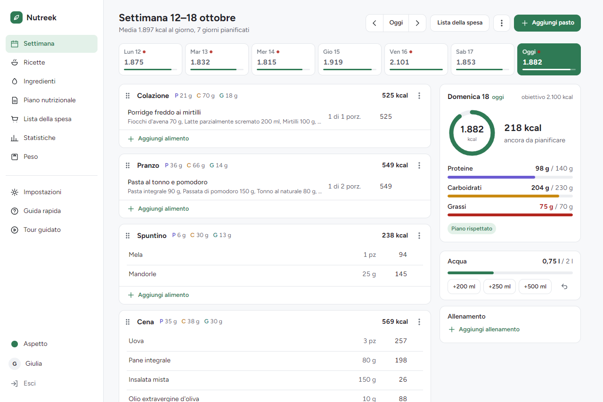
</p>

<p align="center">
  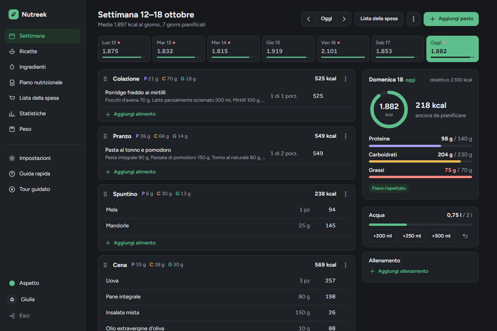
</p>

### Aggiungere un alimento, anche col codice a barre

Il picker si apre sopra la settimana. Con la fotocamera si legge il codice della confezione e il prodotto compare già pronto: prima tra i tuoi ingredienti, poi nella copia locale di OpenFoodFacts.

<p align="center">
  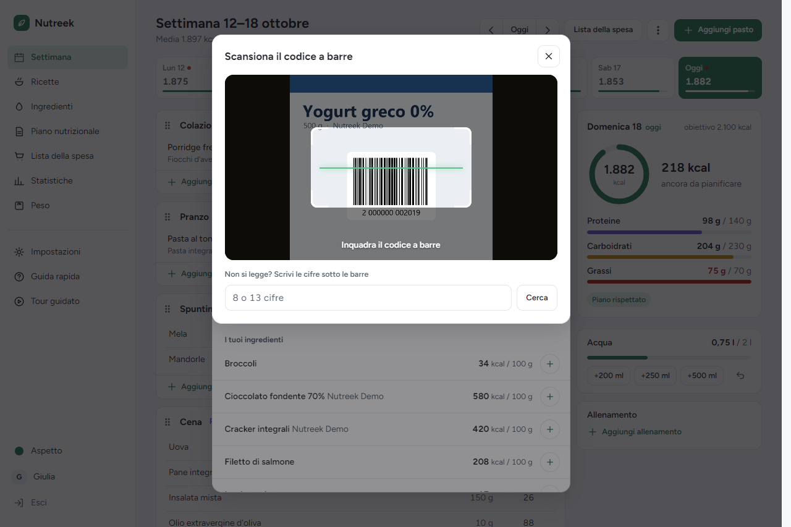
  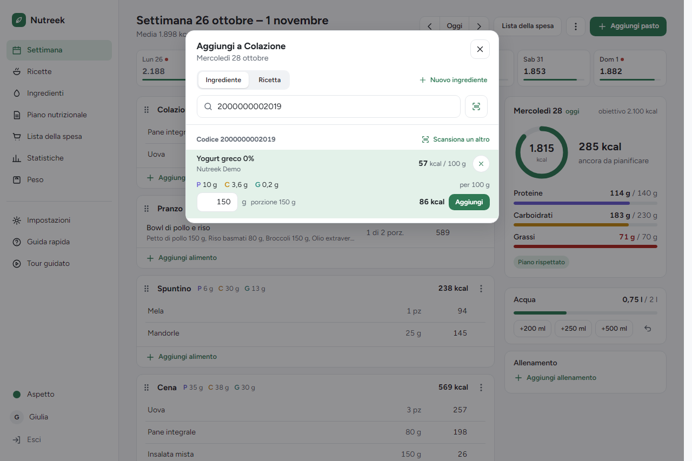
</p>

### Ricette e piano nutrizionale

Ricette con kcal e macro per porzione; il piano nutrizionale con le varianti di ogni pasto, che alimentano il picker e la generazione della settimana.

<p align="center">
  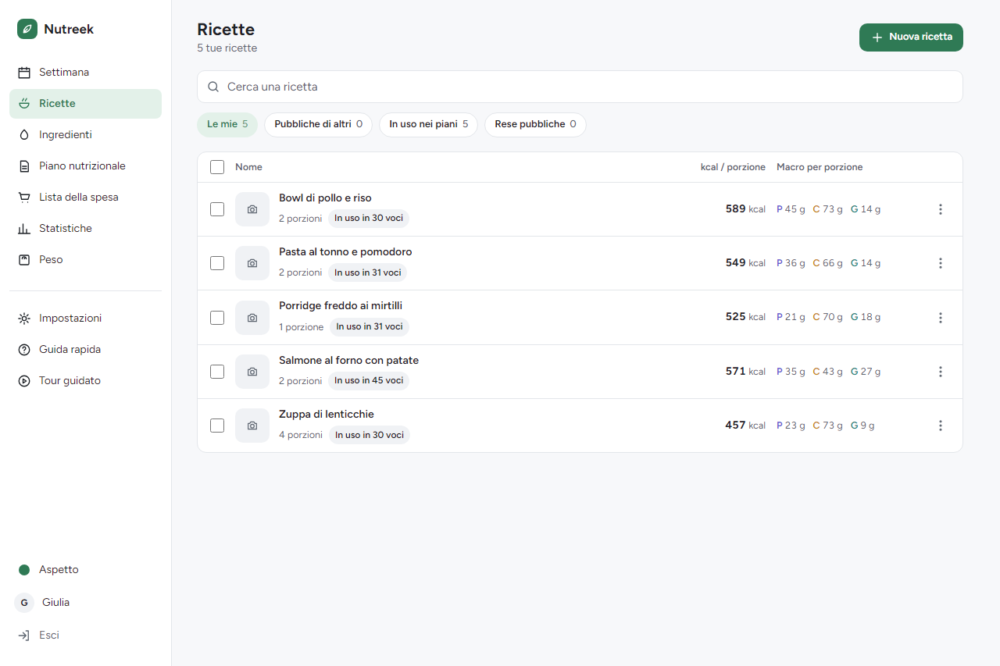
  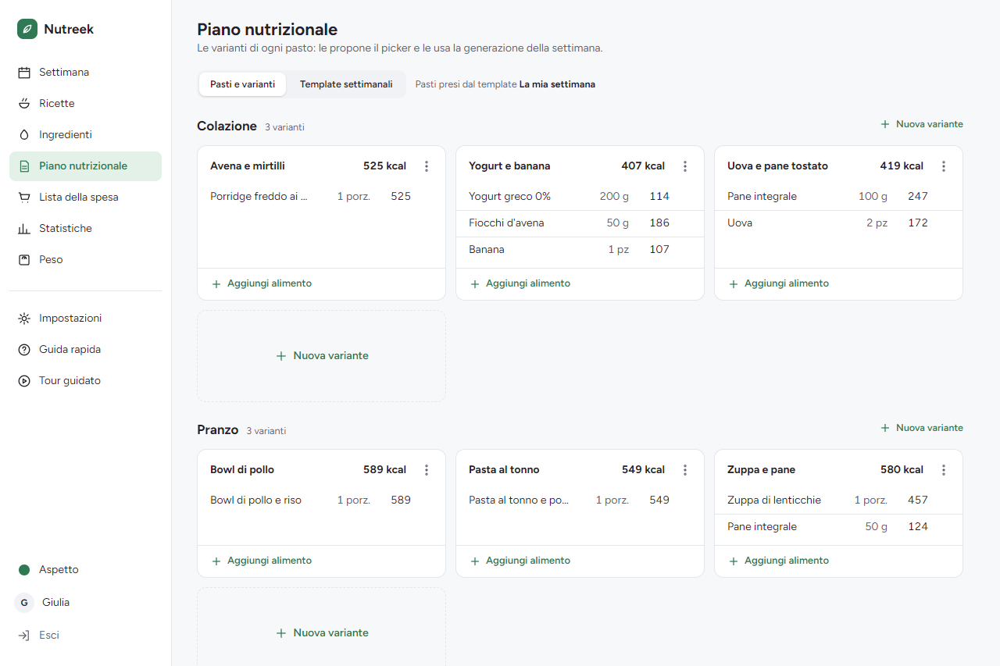
</p>

### Lista della spesa e statistiche

La spesa per reparto, con il carrello e la stampa in due colonne. Le statistiche con il fabbisogno stimato dal peso e da quanto hai mangiato.

<p align="center">
  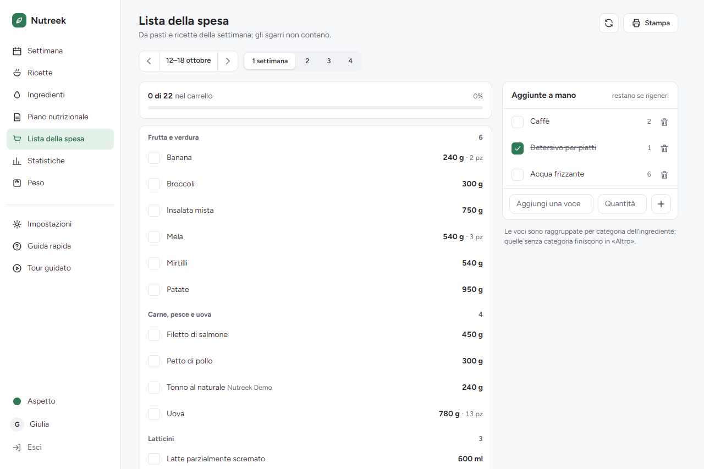
  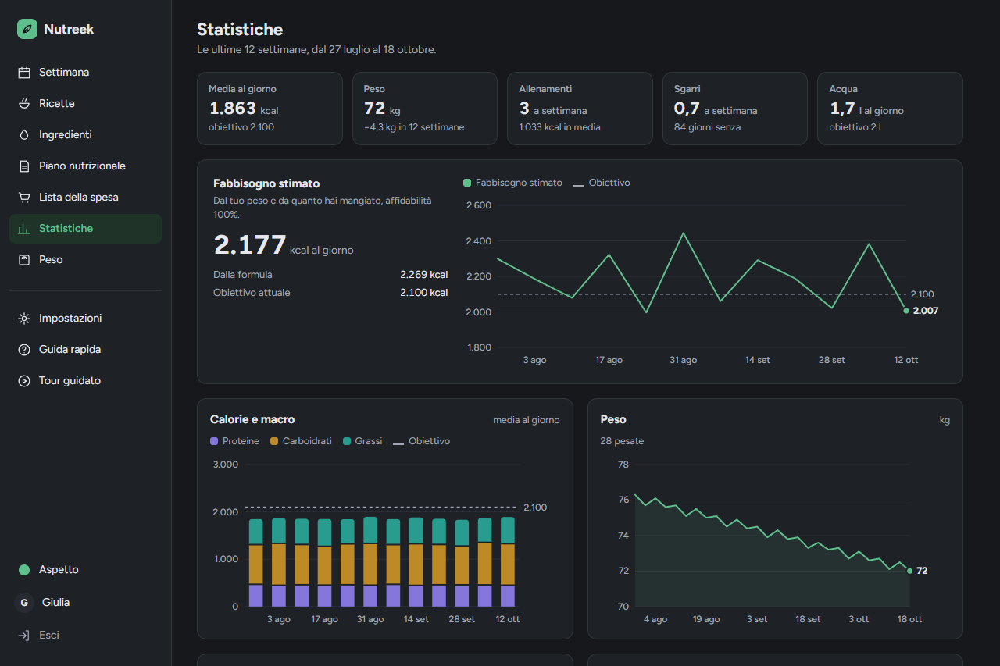
</p>

### Sul telefono

Barra in basso con le sezioni di tutti i giorni; si installa come app da Impostazioni.

<p align="center">
  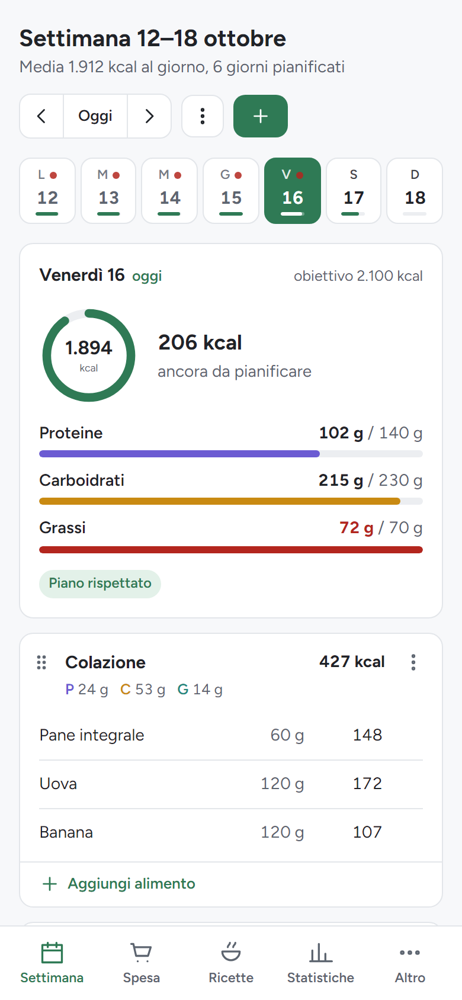
  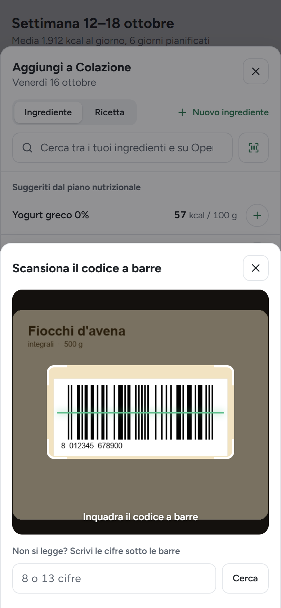
  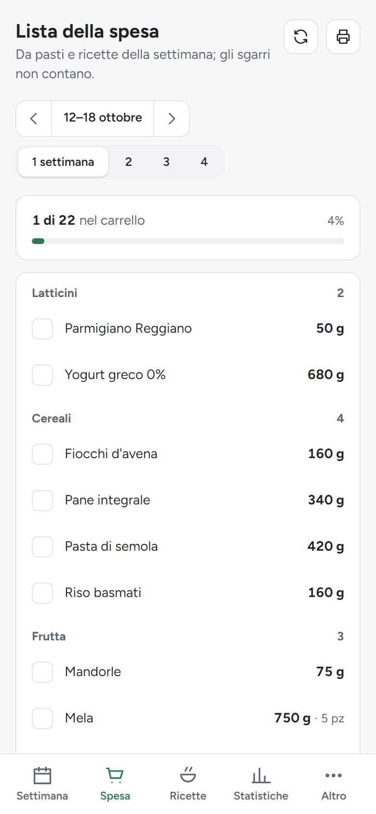
  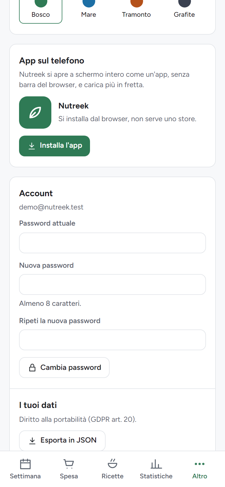
</p>

### Coach e amministrazione

Il pannello coach con clienti e libreria dei piani; l'amministrazione (solo owner) con utenti, funzionalità e sincronizzazione di OpenFoodFacts.

<p align="center">
  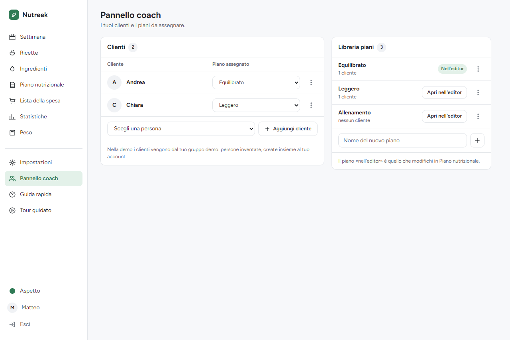
  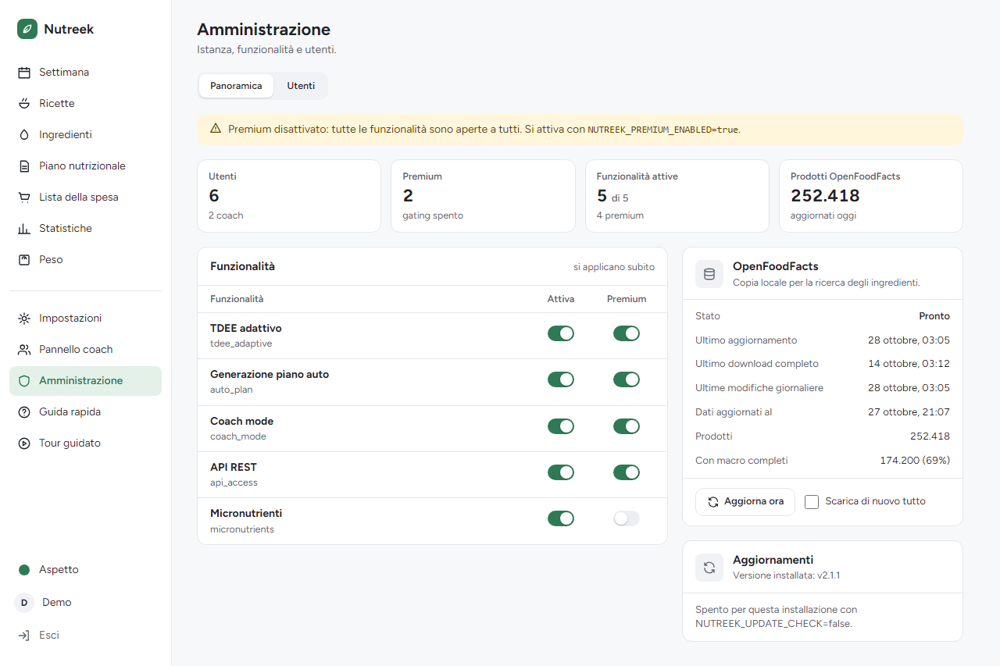
</p>

---

## Stack

- **Backend:** Go 1.27+ (chi, scs, goose, bcrypt, nosurf), SQL scritto a mano
- **DB:** SQLite via `modernc.org/sqlite` (pure Go, no CGO)
- **Frontend:** server-side rendering con `html/template` + HTMX + Tailwind CSS v3.4.17
- **Deploy:** binario statico o immagine Docker distroless (~20 MB)

---

## Requisiti

Per sviluppo nativo (senza Docker):
- Go 1.27 o superiore — https://go.dev/dl/
- Nient'altro. Il CLI standalone di Tailwind viene scaricato automaticamente in `./bin/`.

Per deploy in container:
- Docker 24+ e Docker Compose v2

---

## Quickstart (dev, senza Docker)

### Linux / macOS (con `make`)

```bash
make setup       # scarica Tailwind CLI in ./bin/
make tailwind    # genera internal/web/static/css/tailwind.css
make dev         # go run ./cmd/nutreek -> http://localhost:8080
```

### Windows (PowerShell, senza `make`)

```powershell
pwsh scripts/setup.ps1       # scarica Tailwind CLI in .\bin\
pwsh scripts/tailwind.ps1    # build CSS (aggiungere -Watch per watch mode)
pwsh scripts/dev.ps1         # avvia il server su http://localhost:8080
```

Il DB SQLite viene creato in `./data/nutreek.db` al primo avvio e le migrazioni sono applicate automaticamente. Il CSS generato (`internal/web/static/css/tailwind.css`) è embeddato nel binario a compile-time: va **sempre** rigenerato prima di `go build` o `go run` dopo aver modificato template o classi Tailwind.

---

## Quickstart (Docker)

```bash
# Genera una session key sicura la prima volta
export NUTREEK_SESSION_KEY=$(openssl rand -hex 32)

docker compose up --build
# -> http://localhost:8080
```

Il DB persiste su `./data/` (mappato su `/data` nel container).

### Immagine pubblicata (GHCR)

Ogni GitHub Release `vX.Y.Z` pubblica `ghcr.io/easly1989/nutreek` con i tag
`:latest`, `:vX.Y.Z` e `:vX.Y` (amd64 + arm64). L'immagine è pubblica: non
serve nessun login.

```bash
docker compose pull && docker compose up -d
```

Per tagliare una release: `gh release create vX.Y.Z --generate-notes`
(o dalla UI di GitHub). Il workflow si puo' anche lanciare a mano da
*Actions → Release* per ripubblicare `:latest`. `nutreek -version` stampa
la versione dell'immagine in uso.

### Aggiornare

Una volta al giorno Nutreek legge da GitHub l'ultima versione pubblicata
([`versions.json`](https://raw.githubusercontent.com/easly1989/nutreek/site-data/versions.json);
non invia nulla). Quando esce una release più recente, il proprietario vede
una card nella barra laterale e, in *Amministrazione → Aggiornamenti*, la
versione installata, «Controlla ora» e un interruttore per spegnere il
controllo giornaliero. `NUTREEK_UPDATE_CHECK=false` lo spegne per tutta
l'installazione. Controllano solo le build di release (`vX.Y.Z`).

Nutreek non si aggiorna da solo: sostituire il proprio container
richiederebbe il socket di Docker, cioè tutto il server. Per aggiornare:

1. **Fai un backup** del database: copia `nutreek.db` dalla cartella dei
   dati, o attiva `NUTREEK_BACKUP_ENABLED` (vedi [Backup](#backup)).
2. Scarica la nuova immagine e ricrea il container con gli stessi volumi:

   ```bash
   docker compose pull
   docker compose up -d
   ```

   Con `docker run`: `docker pull ghcr.io/easly1989/nutreek:latest`, poi
   rimuovi il container e riavvialo con le stesse opzioni.

Le migrazioni del database partono da sole all'avvio. Se l'immagine è
fissata a un tag di versione, come `:v2.0`, cambialo con quello nuovo o con
`:latest`. Strumenti come [Watchtower](https://containrrr.dev/watchtower/)
possono scaricare `:latest` al posto tuo; il backup resta da fare.

Non si torna indietro: una versione nuova può cambiare il database in modi
che una più vecchia non sa leggere. Per tornare indietro, ripristina il
backup fatto prima di aggiornare.

Una pagina rimasta aperta durante un aggiornamento (un'app installata resta
aperta per giorni) mostra «Nuova versione di Nutreek pronta» alla prima
azione, con **Ricarica** e **Più tardi**; niente si ricarica da solo.

---

## Configurazione

Tutte le variabili d'ambiente:

| Variabile | Default | Descrizione |
|---|---|---|
| `NUTREEK_ADDR` | `:8080` | Indirizzo di ascolto HTTP |
| `NUTREEK_DB_PATH` | `./data/nutreek.db` | Path del file SQLite |
| `NUTREEK_ENV` | `dev` | `dev` o `prod` (in `prod` abilita secure cookies) |
| `NUTREEK_SESSION_KEY` | *(auto in dev)* | Chiave HMAC per i cookie; **obbligatoria in `prod`** |
| `NUTREEK_OWNER_EMAIL` | *(vuoto)* | Email dell'utente owner: accesso esclusivo all'admin panel |
| `NUTREEK_PREMIUM_ENABLED` | `false` | Se `true`, abilita il gating premium sulle funzionalità a pagamento |
| `NUTREEK_OFF_BASE_URL` | `https://world.openfoodfacts.org` | Override host API OpenFoodFacts (barcode live) |
| `NUTREEK_OFF_DUMP_URL` | `https://static.openfoodfacts.org/data/openfoodfacts-products.jsonl.gz` | URL dump OFF per sync locale |
| `NUTREEK_OFF_SYNC_INTERVAL` | `168h` | Frequenza sync dump OFF (default 7 giorni) |
| `NUTREEK_OFF_SYNC_ENABLED` | `true` | Abilita lo scheduler sync OFF |
| `NUTREEK_RECONCILE_INTERVAL` | `24h` | Frequenza job riconciliazione ingredienti locali vs OFF |
| `NUTREEK_RECONCILE_ENABLED` | `true` | Abilita/disabilita il job di riconciliazione |
| `NUTREEK_ADMIN_TOKEN` | *(opzionale)* | Token per endpoint amministrativi legacy |
| `NUTREEK_BACKUP_ENABLED` | `false` | Abilita backup SQLite automatico periodico |
| `NUTREEK_BACKUP_DIR` | `./data/backups` | Directory dove salvare i backup |
| `NUTREEK_BACKUP_INTERVAL` | `24h` | Frequenza backup automatici |
| `NUTREEK_BACKUP_KEEP` | `7` | Numero di backup da conservare (i più vecchi vengono eliminati) |
| `NUTREEK_UPDATE_CHECK` | `true` | Controlla una volta al giorno se c'è una release più recente e lo dice al proprietario (vedi [Aggiornare](#aggiornare)) |

### OpenFoodFacts

Tutta la ricerca testuale su OpenFoodFacts è **locale**. Una volta alla settimana il sync scarica il dump pubblico di OFF (~0,9 GB compressi), tiene i prodotti italiani (~250k) e li indicizza con SQLite FTS5: le ricerche durano meno di 50 ms e non usano la rete. Al primo avvio la tabella è vuota e il primo sync parte in background (una decina di minuti); finché non finisce le ricerche restano vuote. Solo la lettura per codice di un prodotto non ancora importato chiama l'API live di OFF.

---

## Admin & Premium

### Owner

Il primo utente con email `NUTREEK_OWNER_EMAIL` ottiene accesso all'admin panel (`/admin/panel`), dove può:
- Gestire feature flags (abilitare/disabilitare funzionalità, marcarle come premium)
- Visualizzare e gestire gli utenti registrati
- Assegnare sottoscrizioni premium

```bash
export NUTREEK_OWNER_EMAIL=admin@example.com
```

### Premium gating

Con `NUTREEK_PREMIUM_ENABLED=false` (default), tutte le funzionalità sono accessibili a tutti gli utenti.

Con `NUTREEK_PREMIUM_ENABLED=true`, le funzionalità marcate come premium richiedono una sottoscrizione attiva. L'owner ha sempre accesso completo. Le funzionalità premium includono:

| Feature key | Funzionalità |
|-------------|-------------|
| `auto_plan` | Generazione automatica settimana |
| `tdee_adaptive` | TDEE adattivo con suggerimento automatico |
| `coach_mode` | Pannello coach, libreria piani, assegnazione clienti |
| `api_access` | REST API v1 con Bearer token |

I badge "Premium" nell'interfaccia indicano le funzionalità non disponibili nel piano corrente, con redirect a `/upgrade` al tentativo di utilizzo.

```bash
export NUTREEK_OWNER_EMAIL=admin@example.com
export NUTREEK_PREMIUM_ENABLED=true
```

---

## REST API v1

Crea un token da `/settings` → sezione "Token API", poi:

```bash
TOKEN="nutreek_your_token_here"
BASE="http://localhost:8080"

# Profilo utente corrente
curl -H "Authorization: Bearer $TOKEN" $BASE/api/v1/me

# Piano settimanale (inizio settimana lunedì)
curl -H "Authorization: Bearer $TOKEN" "$BASE/api/v1/week?start=2026-06-09"

# Lista ingredienti (con ricerca)
curl -H "Authorization: Bearer $TOKEN" "$BASE/api/v1/ingredients?q=pollo"

# Log idratazione
curl -X POST -H "Authorization: Bearer $TOKEN" \
     -H "Content-Type: application/json" \
     -d '{"date":"2026-06-12","amount_ml":500}' \
     $BASE/api/v1/water

# Log peso
curl -X POST -H "Authorization: Bearer $TOKEN" \
     -H "Content-Type: application/json" \
     -d '{"date":"2026-06-12","kg":75.5}' \
     $BASE/api/v1/weight

# Log allenamento
curl -X POST -H "Authorization: Bearer $TOKEN" \
     -H "Content-Type: application/json" \
     -d '{"date":"2026-06-12","activity_id":1,"duration_min":45,"kcal_burned":350}' \
     $BASE/api/v1/workout
```

Con `NUTREEK_PREMIUM_ENABLED=true`, la feature `api_access` deve essere abilitata e l'utente deve avere una sottoscrizione attiva per utilizzare l'API.

---

## Deploy pubblico (dietro reverse proxy)

Esempio minimale con [Caddy](https://caddyserver.com/):

```caddyfile
nutreek.example.com {
    reverse_proxy nutreek:8080
}
```

Il container **non** termina TLS: assumi sempre un reverse proxy davanti in produzione pubblica.

Lo scanner del codice a barre e l'installazione come app sul telefono funzionano **solo in https** (o su `localhost`): il browser non dà la fotocamera né registra il service worker su una pagina in http, nemmeno in rete locale. Su http i bottoni dello scanner non compaiono e Impostazioni → «App sul telefono» lo spiega.

Il rate limiting (login, registrazione, ricerca, admin) usa l'IP del client. `X-Forwarded-For` viene letto **solo** quando la connessione arriva da loopback o da una rete privata (il proxy sullo stesso host o nella rete Docker); un client che si collega direttamente non può scegliersi l'IP con l'header. Il proxy deve quindi aggiungere `X-Forwarded-For`: Caddy, Traefik e nginx (`proxy_add_x_forwarded_for`) lo fanno.

L'immagine usa `gcr.io/distroless/static:nonroot` come base finale (~15 MB totali). Niente shell, niente pacchetti: il binario è compilato in pure Go (`CGO_ENABLED=0`). Il container espone una healthcheck via sub-comando `nutreek -healthcheck`.

```bash
nutreek                # avvia il server
nutreek -healthcheck   # GET /healthz, exit 0 se ok 1 altrimenti
```

---

## Backup

Il DB è un singolo file SQLite. Con backup automatico:

```bash
export NUTREEK_BACKUP_ENABLED=true
export NUTREEK_BACKUP_DIR=./data/backups
export NUTREEK_BACKUP_KEEP=7
```

Backup manuale a caldo:

```bash
sqlite3 ./data/nutreek.db ".backup ./data/nutreek.backup.db"
```

---

## Struttura del repository

```
cmd/nutreek/          entrypoint (main.go, -healthcheck subcommand)
internal/
  app/                router (chi), middleware, handler HTTP, rate limiter
  auth/               password hashing (bcrypt), sessioni
  config/             caricamento variabili d'ambiente (NUTREEK_*)
  db/
    migrations/       SQL goose versionate (embedded nel binary)
  domain/             struct di dominio pure
  macros/             calcoli macro (puri, testati)
  off/                client OpenFoodFacts + sync dump locale + reconciler
  planner/            algoritmo greedy generazione piano settimanale
  profile/            logica salvataggio profilo (BMI, BMR, target macro)
  recipeimport/       import ricetta da URL (schema.org/Recipe)
  service/            orchestrazione business logic (PlannerService, TDEEService)
  tdee/               calcolo TDEE adattivo (trend peso/intake)
  web/
    templates/        HTML con HTMX (embedded nel binary)
    static/           CSS e JS (embedded, generati)
web/tailwind/         tailwind.config.js + input.css (sorgenti CSS)
scripts/              PowerShell helpers per Windows
data/                 SQLite DB a runtime (gitignored)
```

---

## Licenza

Nutreek è distribuito con la **GNU Affero General Public License v3.0**: vedi [LICENSE](LICENSE). Se fai girare una versione modificata come servizio in rete, l'AGPL ti chiede di offrire il codice modificato a chi la usa.

---

## Supporta il progetto

Nutreek è open source e sviluppato da una persona sola, nel tempo libero. Se ti è utile, una donazione aiuta davvero ed è molto apprezzata. ♥ Il modo più semplice è
[**Buy Me a Coffee**](https://buymeacoffee.com/easly1989). Se ne preferisci un altro, la
[pagina delle donazioni](https://easly1989.github.io/donate.html) li elenca tutti:
[PayPal](https://paypal.me/carloruggiero),
[Stripe](https://buy.stripe.com/8x26oAeqA7h6dPk80hfbq00),
[Liberapay](https://liberapay.com/amon2126/donate) o
[GitHub Sponsors](https://github.com/sponsors/easly1989).
