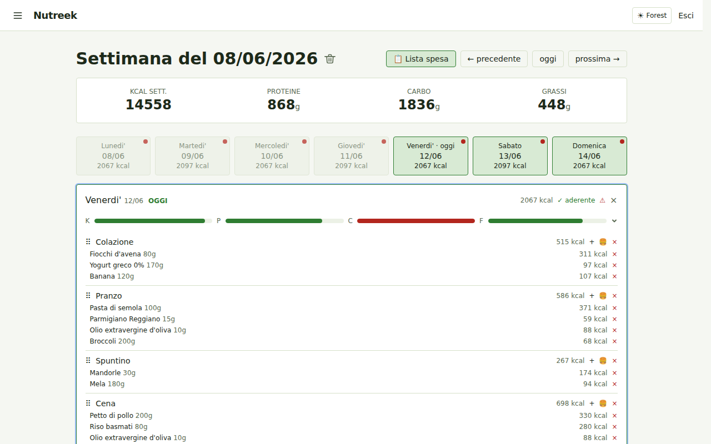
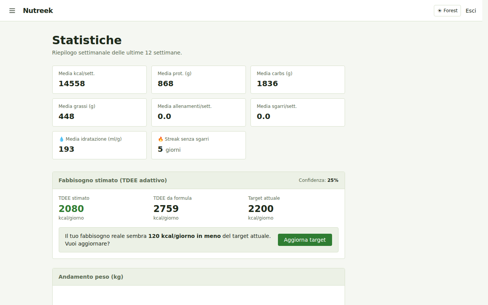
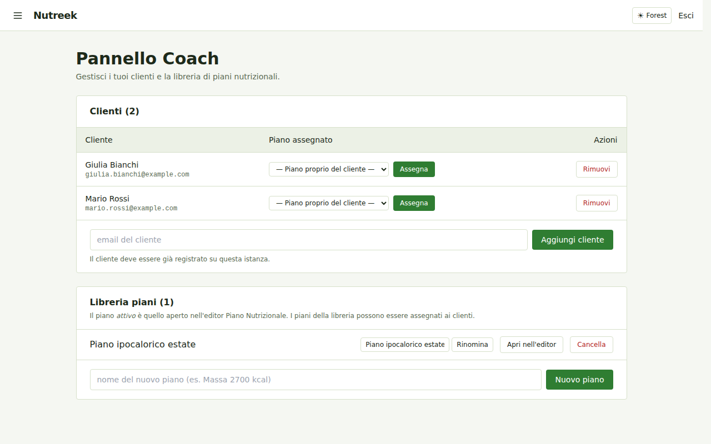
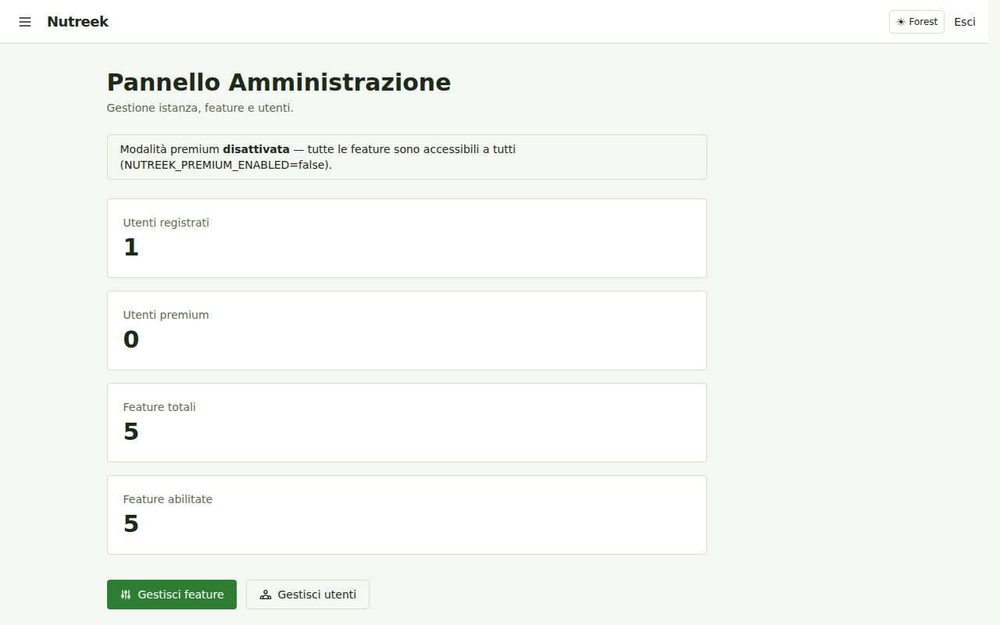
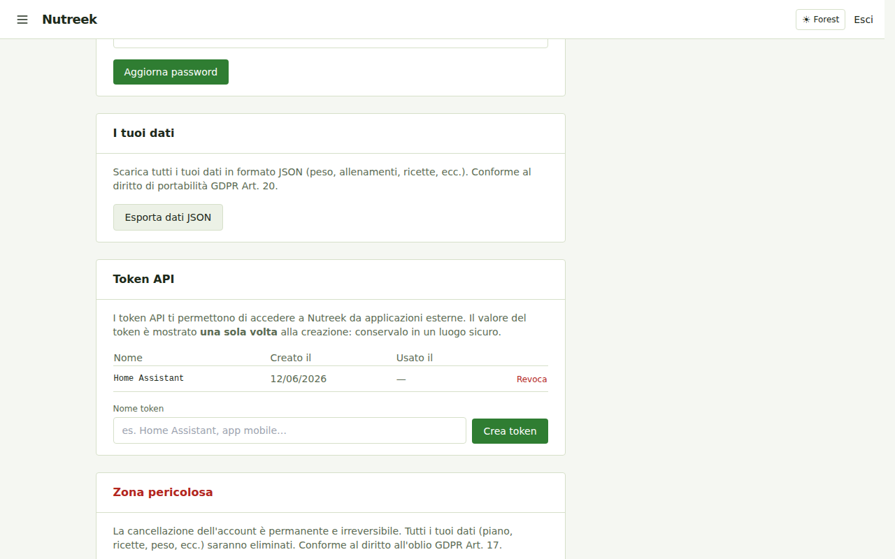

# Nutreek

Webapp self-hosted per gestire il piano nutrizionale settimanale: ingredienti (con integrazione OpenFoodFacts locale via FTS5), ricette, template di pasti, vista settimanale con calcolo macro (Kcal / Proteine / Carboidrati / Grassi) per pasto, giorno e settimana.

Eseguibile sia **nativamente** (binario Go, nessuna dipendenza esterna) sia in un **singolo container Docker** (nessun servizio esterno: SQLite embedded).

---

## Funzionalità

| Area | Funzionalità |
|------|-------------|
| **Piani settimanali** | Calendario settimanale, macro per pasto/giorno/settimana, sgarri, copia da settimana precedente |
| **Ingredienti** | Ricerca locale FTS5 (<50 ms, offline), import da barcode/URL, riconciliazione OFF |
| **Ricette** | Creazione con ingredienti, import automatico da URL (schema.org/Recipe) |
| **Template** | Template settimanali riutilizzabili, applicazione one-click |
| **Piano nutrizionista** | Varianti pasto, generazione automatica settimana con algoritmo greedy (target macro) |
| **Lista spesa** | Generazione automatica dalla settimana selezionata |
| **Peso & idratazione** | Tracciamento giornaliero, grafici trend |
| **TDEE adattivo** | Calcolo TDEE da trend peso/intake, suggerimento automatico |
| **Allenamenti** | Log allenamenti con calorie bruciate, dashboard settimanale |
| **Coach mode** | Libreria piani, assegnazione clienti, storico freeze, dashboard coach |
| **REST API v1** | Bearer token, endpoint per settimana, ingredienti, peso, idratazione, allenamenti |
| **Admin panel** | Feature flags, gestione utenti, sottoscrizioni premium (owner-only) |
| **Premium gating** | Middleware `requireFeature`, cache 60s, badge UI, redirect `/upgrade` |
| **UI** | 4 temi (forest/ocean/sunset/mono), sidebar PIN, tour guidato, HTMX |

---

## Screenshot

### Dashboard settimanale

Calendario con pasti, macro per giorno e settimana, barre di aderenza ai target, idratazione inline.

<p align="center">
  
</p>

### Statistiche & TDEE adattivo

Riepilogo settimanale, stima del fabbisogno reale dal trend peso/intake con suggerimento di aggiornamento target.

<p align="center">
  
</p>

### Pannello Coach

Gestione clienti, assegnazione piani nutrizionali, libreria piani riutilizzabili.

<p align="center">
  
</p>

### Admin panel

Feature flags, gestione utenti e sottoscrizioni premium (solo owner).

<p align="center">
  
</p>

### Token API

Creazione e revoca token per la REST API v1 dalle impostazioni.

<p align="center">
  
</p>

---

## Stack

- **Backend:** Go 1.27+ (chi, scs, goose, bcrypt, nosurf), SQL scritto a mano
- **DB:** SQLite via `modernc.org/sqlite` (pure Go, no CGO)
- **Frontend:** server-side rendering con `html/template` + HTMX + Tailwind CSS v3.4.17
- **Deploy:** binario statico o immagine Docker distroless (~20 MB)

---

## Requisiti

Per sviluppo nativo (senza Docker):
- Go 1.25 o superiore — https://go.dev/dl/
- Nient'altro. Il CLI standalone di Tailwind viene scaricato automaticamente in `./bin/`.

Per deploy in container:
- Docker 24+ e Docker Compose v2

---

## Quickstart (dev, senza Docker)

### Linux / macOS (con `make`)

```bash
make setup       # scarica Tailwind CLI in ./bin/
make tailwind    # genera internal/web/static/css/tailwind.css
make dev         # go run ./cmd/nutreek -> http://localhost:8080
```

### Windows (PowerShell, senza `make`)

```powershell
pwsh scripts/setup.ps1       # scarica Tailwind CLI in .\bin\
pwsh scripts/tailwind.ps1    # build CSS (aggiungere -Watch per watch mode)
pwsh scripts/dev.ps1         # avvia il server su http://localhost:8080
```

Il DB SQLite viene creato in `./data/nutreek.db` al primo avvio e le migrazioni sono applicate automaticamente. Il CSS generato (`internal/web/static/css/tailwind.css`) è embeddato nel binario a compile-time: va **sempre** rigenerato prima di `go build` o `go run` dopo aver modificato template o classi Tailwind.

---

## Quickstart (Docker)

```bash
# Genera una session key sicura la prima volta
export NUTREEK_SESSION_KEY=$(openssl rand -hex 32)

docker compose up --build
# -> http://localhost:8080
```

Il DB persiste su `./data/` (mappato su `/data` nel container).

### Immagine pubblicata (GHCR, privata)

Ogni GitHub Release `vX.Y.Z` pubblica `ghcr.io/easly1989/nutreek` con i tag
`:latest`, `:vX.Y.Z` e `:vX.Y` (amd64 + arm64). Il pacchetto e' privato:
sul server serve un login una tantum con un Personal Access Token che abbia
lo scope `read:packages`.

```bash
echo "$GHCR_PAT" | docker login ghcr.io -u easly1989 --password-stdin
docker compose pull && docker compose up -d
```

Per tagliare una release: `gh release create vX.Y.Z --generate-notes`
(o dalla UI di GitHub). Il workflow si puo' anche lanciare a mano da
*Actions → Release* per ripubblicare `:latest`. `nutreek -version` stampa
la versione dell'immagine in uso.

---

## Configurazione

Tutte le variabili d'ambiente:

| Variabile | Default | Descrizione |
|---|---|---|
| `NUTREEK_ADDR` | `:8080` | Indirizzo di ascolto HTTP |
| `NUTREEK_DB_PATH` | `./data/nutreek.db` | Path del file SQLite |
| `NUTREEK_ENV` | `dev` | `dev` o `prod` (in `prod` abilita secure cookies) |
| `NUTREEK_SESSION_KEY` | *(auto in dev)* | Chiave HMAC per i cookie; **obbligatoria in `prod`** |
| `NUTREEK_OWNER_EMAIL` | *(vuoto)* | Email dell'utente owner: accesso esclusivo all'admin panel |
| `NUTREEK_PREMIUM_ENABLED` | `false` | Se `true`, abilita il gating premium sulle funzionalità a pagamento |
| `NUTREEK_OFF_BASE_URL` | `https://world.openfoodfacts.org` | Override host API OpenFoodFacts (barcode live) |
| `NUTREEK_OFF_DUMP_URL` | `https://static.openfoodfacts.org/data/openfoodfacts-products.jsonl.gz` | URL dump OFF per sync locale |
| `NUTREEK_OFF_SYNC_INTERVAL` | `168h` | Frequenza sync dump OFF (default 7 giorni) |
| `NUTREEK_OFF_SYNC_ENABLED` | `true` | Abilita lo scheduler sync OFF |
| `NUTREEK_RECONCILE_INTERVAL` | `24h` | Frequenza job riconciliazione ingredienti locali vs OFF |
| `NUTREEK_RECONCILE_ENABLED` | `true` | Abilita/disabilita il job di riconciliazione |
| `NUTREEK_ADMIN_TOKEN` | *(opzionale)* | Token per endpoint amministrativi legacy |
| `NUTREEK_BACKUP_ENABLED` | `false` | Abilita backup SQLite automatico periodico |
| `NUTREEK_BACKUP_DIR` | `./data/backups` | Directory dove salvare i backup |
| `NUTREEK_BACKUP_INTERVAL` | `24h` | Frequenza backup automatici |
| `NUTREEK_BACKUP_KEEP` | `7` | Numero di backup da conservare (i più vecchi vengono eliminati) |

---

## Admin & Premium

### Owner

Il primo utente con email `NUTREEK_OWNER_EMAIL` ottiene accesso all'admin panel (`/admin/panel`), dove può:
- Gestire feature flags (abilitare/disabilitare funzionalità, marcarle come premium)
- Visualizzare e gestire gli utenti registrati
- Assegnare sottoscrizioni premium

```bash
export NUTREEK_OWNER_EMAIL=admin@example.com
```

### Premium gating

Con `NUTREEK_PREMIUM_ENABLED=false` (default), tutte le funzionalità sono accessibili a tutti gli utenti.

Con `NUTREEK_PREMIUM_ENABLED=true`, le funzionalità marcate come premium richiedono una sottoscrizione attiva. L'owner ha sempre accesso completo. Le funzionalità premium includono:

| Feature key | Funzionalità |
|-------------|-------------|
| `auto_plan` | Generazione automatica settimana |
| `tdee_adaptive` | TDEE adattivo con suggerimento automatico |
| `coach_mode` | Pannello coach, libreria piani, assegnazione clienti |
| `api_access` | REST API v1 con Bearer token |

I badge "Premium" nell'interfaccia indicano le funzionalità non disponibili nel piano corrente, con redirect a `/upgrade` al tentativo di utilizzo.

```bash
export NUTREEK_OWNER_EMAIL=admin@example.com
export NUTREEK_PREMIUM_ENABLED=true
```

---

## REST API v1

Crea un token da `/settings` → sezione "Token API", poi:

```bash
TOKEN="nutreek_your_token_here"
BASE="http://localhost:8080"

# Profilo utente corrente
curl -H "Authorization: Bearer $TOKEN" $BASE/api/v1/me

# Piano settimanale (inizio settimana lunedì)
curl -H "Authorization: Bearer $TOKEN" "$BASE/api/v1/week?start=2026-06-09"

# Lista ingredienti (con ricerca)
curl -H "Authorization: Bearer $TOKEN" "$BASE/api/v1/ingredients?q=pollo"

# Log idratazione
curl -X POST -H "Authorization: Bearer $TOKEN" \
     -H "Content-Type: application/json" \
     -d '{"date":"2026-06-12","amount_ml":500}' \
     $BASE/api/v1/water

# Log peso
curl -X POST -H "Authorization: Bearer $TOKEN" \
     -H "Content-Type: application/json" \
     -d '{"date":"2026-06-12","kg":75.5}' \
     $BASE/api/v1/weight

# Log allenamento
curl -X POST -H "Authorization: Bearer $TOKEN" \
     -H "Content-Type: application/json" \
     -d '{"date":"2026-06-12","activity_id":1,"duration_min":45,"kcal_burned":350}' \
     $BASE/api/v1/workout
```

Con `NUTREEK_PREMIUM_ENABLED=true`, la feature `api_access` deve essere abilitata e l'utente deve avere una sottoscrizione attiva per utilizzare l'API.

---

## Deploy pubblico (dietro reverse proxy)

Esempio minimale con [Caddy](https://caddyserver.com/):

```caddyfile
nutreek.example.com {
    reverse_proxy nutreek:8080
}
```

Il container **non** termina TLS: assumi sempre un reverse proxy davanti in produzione pubblica.

Lo scanner del codice a barre e l'installazione come app sul telefono funzionano **solo in https** (o su `localhost`): il browser non dà la fotocamera né registra il service worker su una pagina in http, nemmeno in rete locale. Su http i bottoni dello scanner non compaiono e Impostazioni → «App sul telefono» lo spiega.

Il rate limiting (login, registrazione, ricerca, admin) usa l'IP del client. `X-Forwarded-For` viene letto **solo** quando la connessione arriva da loopback o da una rete privata (il proxy sullo stesso host o nella rete Docker); un client che si collega direttamente non può scegliersi l'IP con l'header. Il proxy deve quindi aggiungere `X-Forwarded-For`: Caddy, Traefik e nginx (`proxy_add_x_forwarded_for`) lo fanno.

L'immagine usa `gcr.io/distroless/static:nonroot` come base finale (~15 MB totali). Niente shell, niente pacchetti: il binario è compilato in pure Go (`CGO_ENABLED=0`). Il container espone una healthcheck via sub-comando `nutreek -healthcheck`.

```bash
nutreek                # avvia il server
nutreek -healthcheck   # GET /healthz, exit 0 se ok 1 altrimenti
```

---

## Backup

Il DB è un singolo file SQLite. Con backup automatico:

```bash
export NUTREEK_BACKUP_ENABLED=true
export NUTREEK_BACKUP_DIR=./data/backups
export NUTREEK_BACKUP_KEEP=7
```

Backup manuale a caldo:

```bash
sqlite3 ./data/nutreek.db ".backup ./data/nutreek.backup.db"
```

---

## Struttura del repository

```
cmd/nutreek/          entrypoint (main.go, -healthcheck subcommand)
internal/
  app/                router (chi), middleware, handler HTTP, rate limiter
  auth/               password hashing (bcrypt), sessioni
  config/             caricamento variabili d'ambiente (NUTREEK_*)
  db/
    migrations/       SQL goose versionate (embedded nel binary)
  domain/             struct di dominio pure
  macros/             calcoli macro (puri, testati)
  off/                client OpenFoodFacts + sync dump locale + reconciler
  planner/            algoritmo greedy generazione piano settimanale
  profile/            logica salvataggio profilo (BMI, BMR, target macro)
  recipeimport/       import ricetta da URL (schema.org/Recipe)
  service/            orchestrazione business logic (PlannerService, TDEEService)
  tdee/               calcolo TDEE adattivo (trend peso/intake)
  web/
    templates/        HTML con HTMX (embedded nel binary)
    static/           CSS e JS (embedded, generati)
web/tailwind/         tailwind.config.js + input.css (sorgenti CSS)
scripts/              PowerShell helpers per Windows
data/                 SQLite DB a runtime (gitignored)
```

---

## Licenza

**Proprietaria — All Rights Reserved.** Vedi [LICENSE](LICENSE).

Il codice è visibile ma **non** è open source: nessun uso, copia o distribuzione è consentito senza autorizzazione scritta del titolare.
