<p align="center">
  
</p>

<h1 align="center">Nutreek</h1>

<p align="center">
  <strong>Your week of meals, self-hosted.</strong><br />
  An open-source, self-hosted web app to plan meals and track macros per meal, day and week.
</p>

<p align="center">
  <strong>English</strong> · <a href="README.it.md">Italiano</a>
</p>

<p align="center">
  <a href="https://github.com/easly1989/nutreek/actions/workflows/ci.yml"></a>
  <a href="https://github.com/easly1989/nutreek/pkgs/container/nutreek"></a>
  <a href="LICENSE"></a>
</p>

<p align="center">
  <a href="https://buymeacoffee.com/easly1989"></a>
  <a href="https://paypal.me/carloruggiero"></a>
  <a href="https://buy.stripe.com/8x26oAeqA7h6dPk80hfbq00"></a>
  <a href="https://liberapay.com/amon2126/donate"></a>
  <a href="https://github.com/sponsors/easly1989"></a>
</p>

Ingredients from a local copy of OpenFoodFacts (search in under 50 ms, even offline) and a barcode scanner, recipes, a nutrition plan with meal variants and automatic week generation, a shopping list, weight tracking with adaptive TDEE, and a coach mode. It installs on your phone like an app.

It runs **natively** (one Go binary, no external dependencies) or in **a single Docker container**: SQLite is built in, so there is no separate database to run.

The interface is in **English** and **Italian**. Each user picks the language in Settings; without a choice it follows the browser, and the signed-out pages have a selector. Anyone can add another language with a pull request: see [Translating Nutreek](docs/translating.md).

---

## Features

| Area | What it does |
|------|-------------|
| **Weekly plans** | One day at a time with a calorie ring and macros, meals, water and workouts; macros per meal, day and week, cheat meals, copy from the previous week |
| **Ingredients** | Local FTS5 search (<50 ms, offline) with product photos, a barcode scanner in every food picker, OpenFoodFacts reconciliation |
| **Recipes** | Built from ingredients, imported automatically from a URL (schema.org/Recipe) |
| **Templates** | Reusable weekly templates, applied in one click |
| **Nutrition plan** | Meal variants, automatic week generation with a greedy algorithm that aims at your macro targets |
| **Shopping list** | Generated from the selected week, grouped by aisle |
| **Weight & hydration** | Daily tracking, trend charts |
| **Adaptive TDEE** | Estimates your real energy needs from your weight and intake trend, and suggests new targets |
| **Workouts** | Workout log with calories burned, weekly overview |
| **Coach mode** | Plan library, client assignment, frozen plan history, coach dashboard |
| **REST API v1** | Bearer tokens; endpoints for the week, ingredients, weight, hydration and workouts |
| **Admin panel** | Feature flags, user management, premium subscriptions (owner only) |
| **Premium gating** | `requireFeature` middleware, 60 s cache, UI badges, redirect to `/upgrade` |
| **Look** | The «Sereno» style: light / dark / follow the system × forest / sea / sunset / graphite colour; sidebar on desktop, bottom bar on the phone; guided tour |
| **Languages** | English and Italian, per user or from the browser; community translations welcome, marked beta until complete ([guide](docs/translating.md)) |
| **On your phone** | Installable (manifest and icons in your chosen colour, a service worker for static files); the camera and installing need https |

---

## Screenshots

Demo data, with the interface in English (the demo foods and meals are Italian). The same look in light and dark, on desktop and on the phone. The Italian README shows the Italian interface.

### The week

One day at a time: the day tabs with their calories, the meals with their macros, and beside them the calorie ring, water and workouts.

<p align="center">
  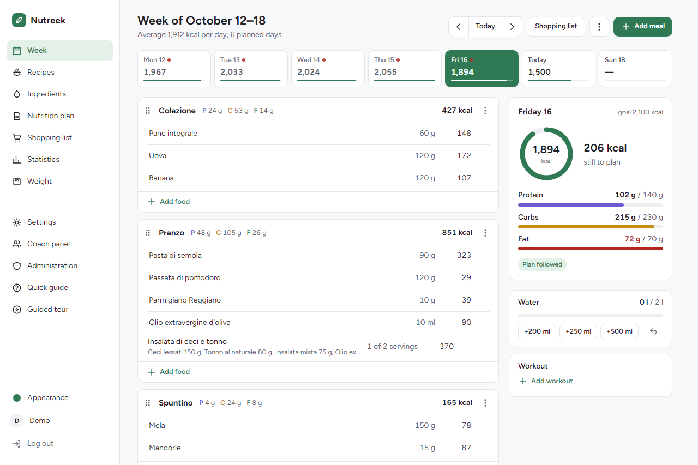
</p>

<p align="center">
  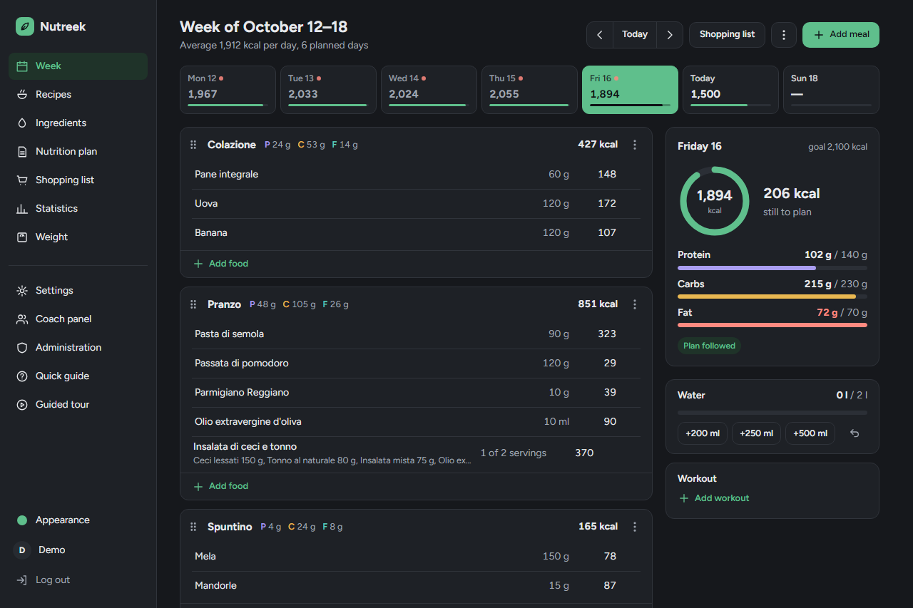
</p>

### Adding food, barcode included

The picker opens over the week. The camera reads the barcode on the pack and the product shows up ready to add: first among your own ingredients, then in the local OpenFoodFacts copy.

<p align="center">
  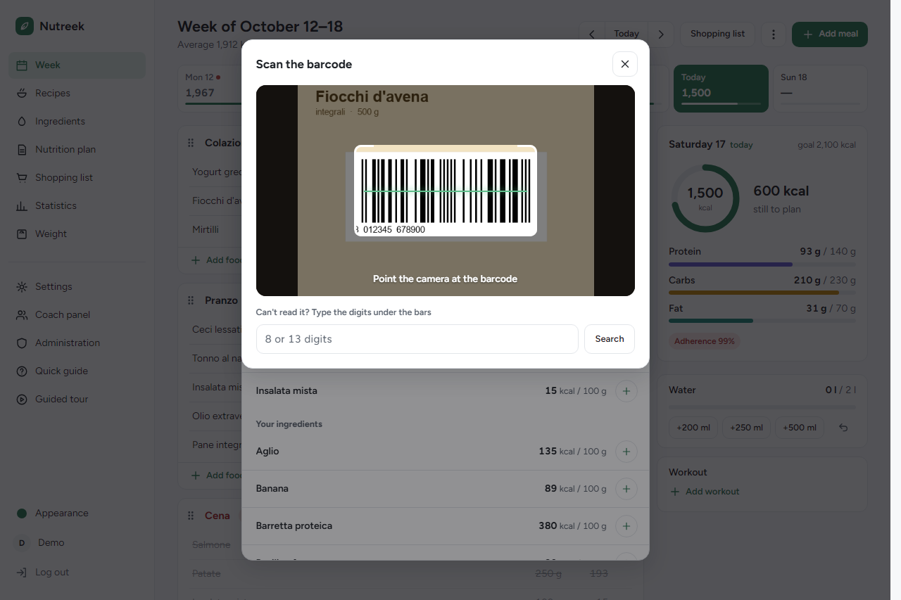
  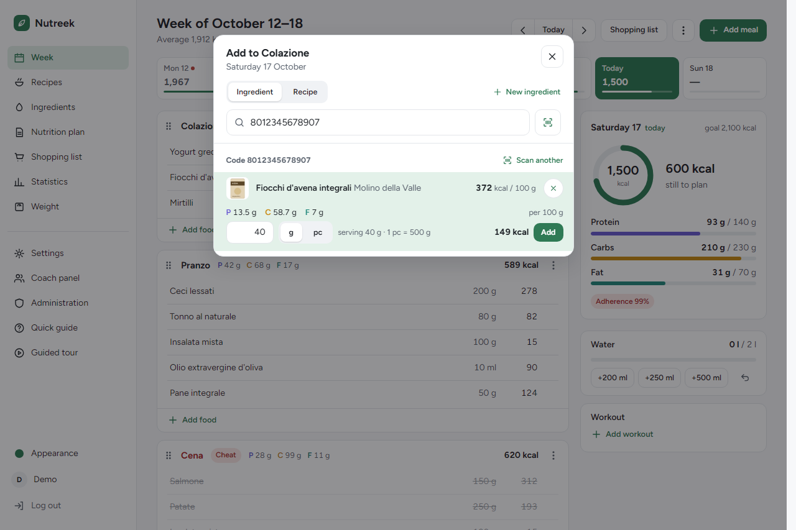
</p>

### Recipes and nutrition plan

Recipes with calories and macros per serving; the nutrition plan with the variants of each meal, which feed the picker and the week generator.

<p align="center">
  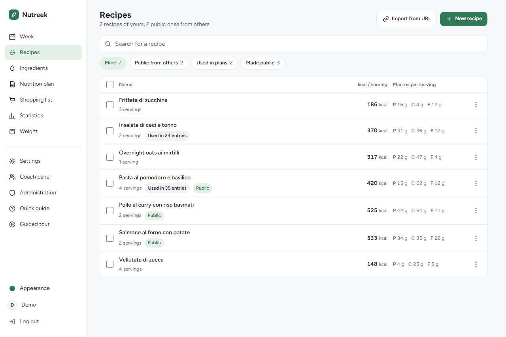
  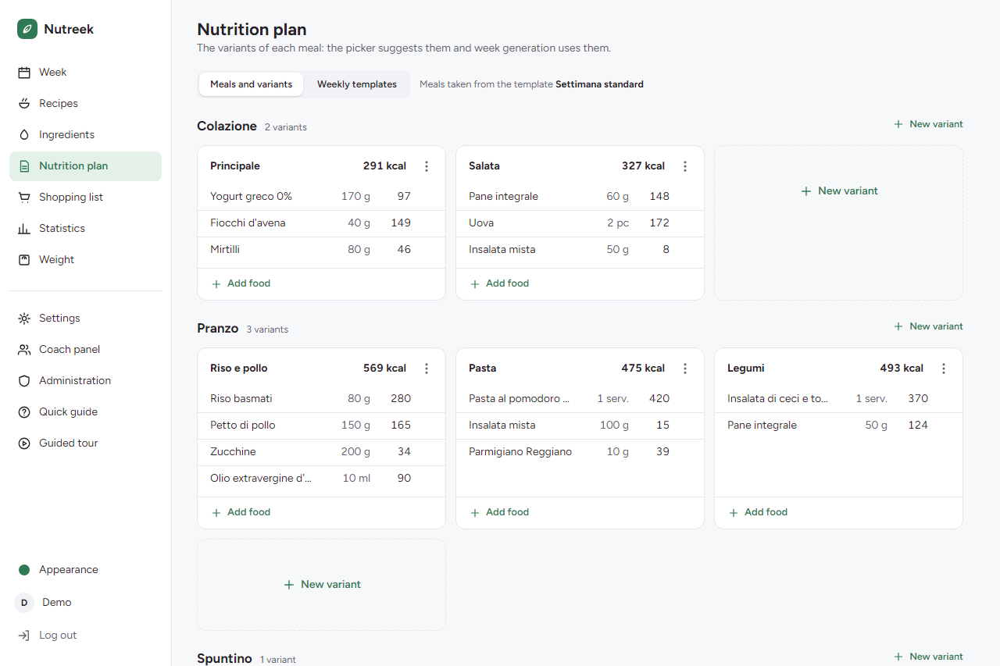
</p>

### Shopping list and statistics

The shopping list by aisle, with a cart and a two-column print. Statistics with your energy needs estimated from your weight and what you ate.

<p align="center">
  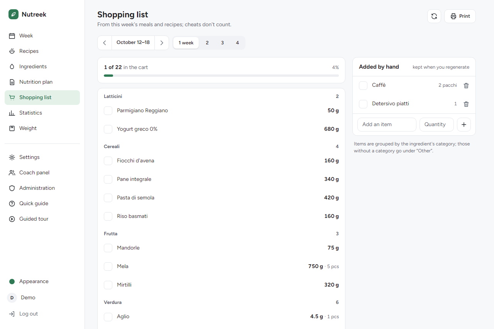
  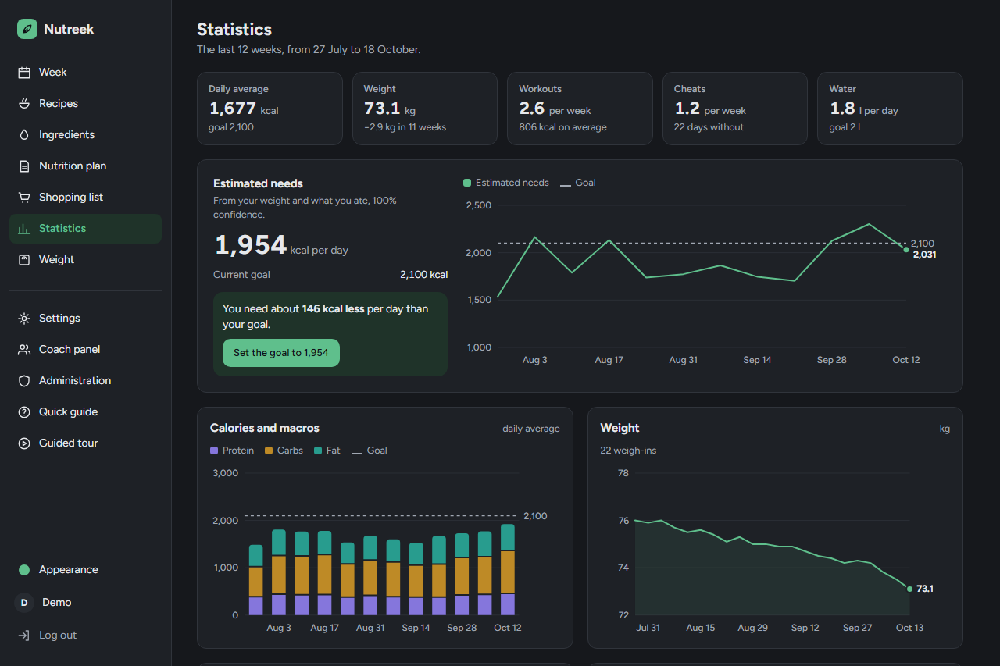
</p>

### On the phone

A bottom bar with the everyday sections; it installs as an app from Settings.

<p align="center">
  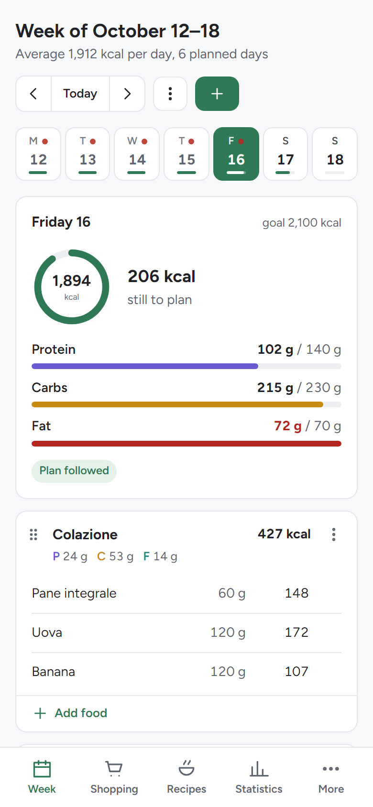
  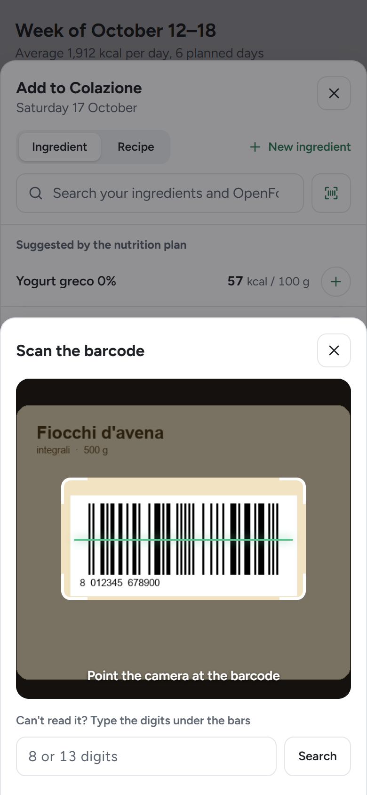
  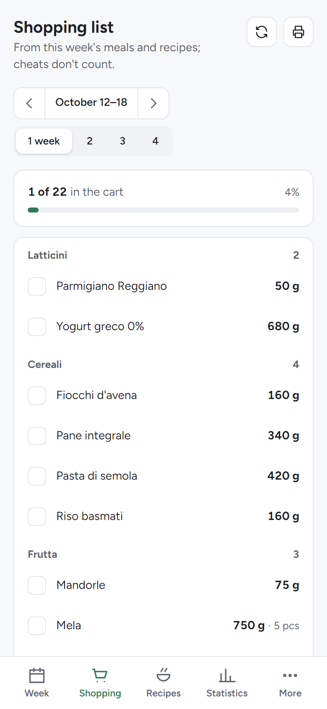
  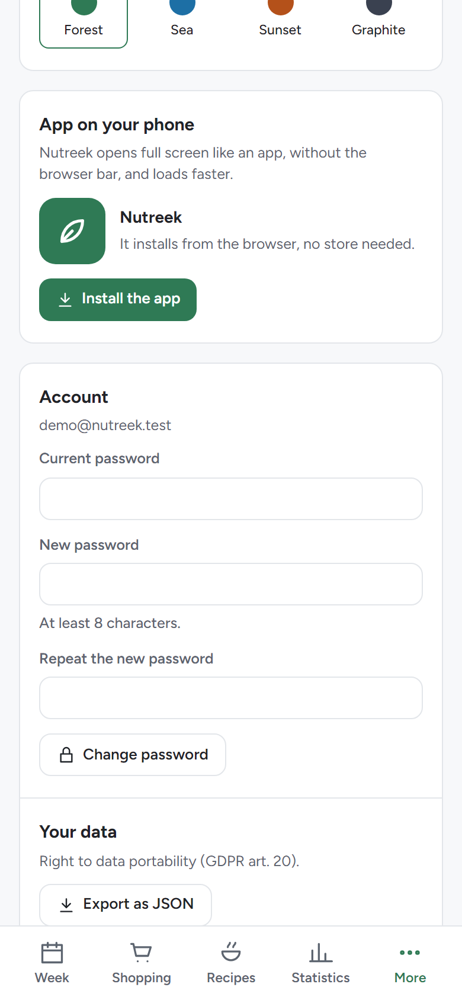
</p>

### Coach and administration

The coach panel with clients and the plan library; administration (owner only) with users, features and the OpenFoodFacts sync.

<p align="center">
  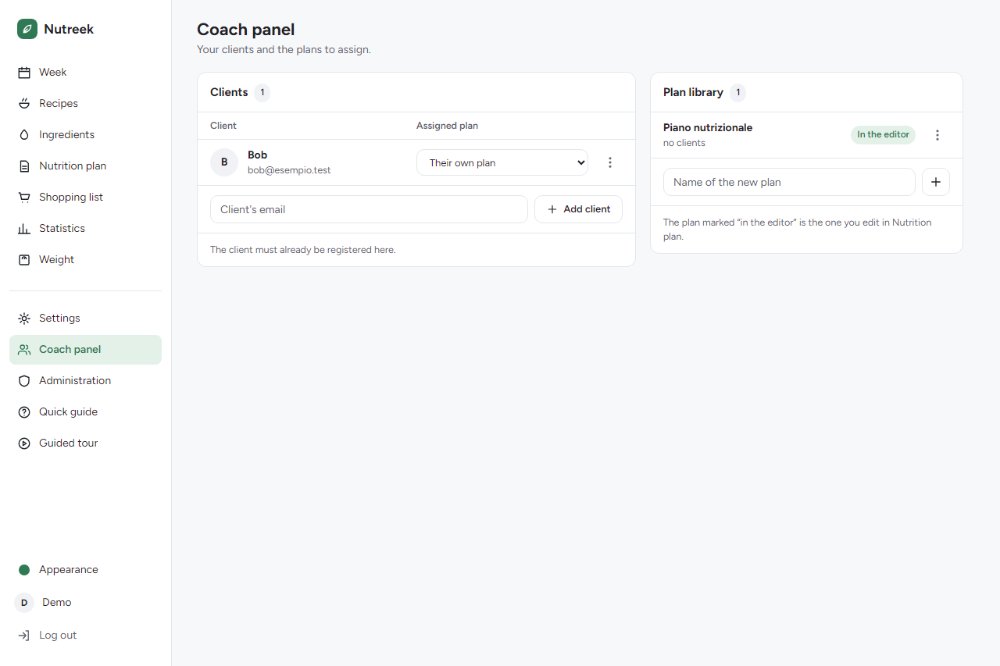
  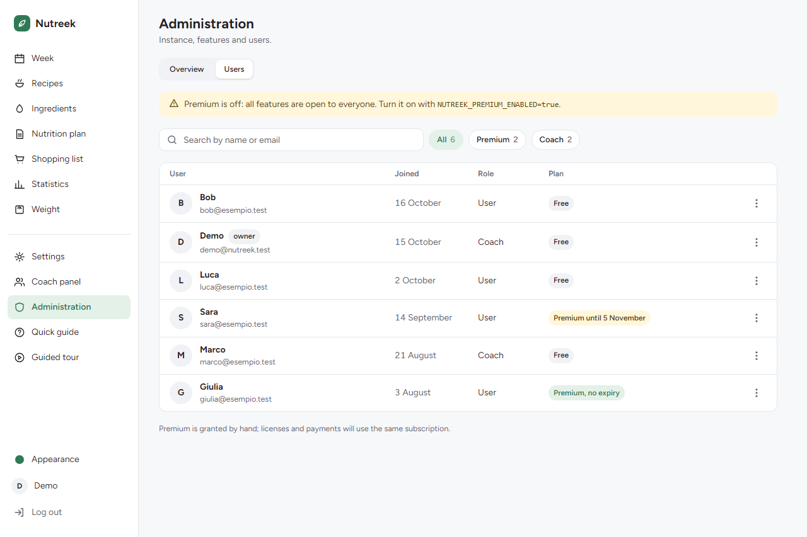
</p>

---

## Stack

- **Backend:** Go 1.27+ (chi, scs, goose, bcrypt, nosurf), hand-written SQL
- **Database:** SQLite via `modernc.org/sqlite` (pure Go, no CGO)
- **Frontend:** server-side rendering with `html/template` + HTMX + Tailwind CSS v3.4.17
- **Deploy:** a static binary or a distroless Docker image (~20 MB)

---

## Requirements

For native development (no Docker):
- Go 1.27 or later — https://go.dev/dl/
- Nothing else. The standalone Tailwind CLI is downloaded into `./bin/` for you.

For a container deploy:
- Docker 24+ and Docker Compose v2

---

## Quickstart (dev, no Docker)

### Linux / macOS (with `make`)

```bash
make setup       # downloads the Tailwind CLI into ./bin/
make tailwind    # builds internal/web/static/css/tailwind.css
make dev         # go run ./cmd/nutreek -> http://localhost:8080
```

### Windows (PowerShell, no `make`)

```powershell
pwsh scripts/setup.ps1       # downloads the Tailwind CLI into .\bin\
pwsh scripts/tailwind.ps1    # builds the CSS (add -Watch for watch mode)
pwsh scripts/dev.ps1         # starts the server on http://localhost:8080
```

The SQLite database is created in `./data/nutreek.db` on first start, and migrations run automatically. The generated CSS (`internal/web/static/css/tailwind.css`) is embedded in the binary at compile time: **always** rebuild it before `go build` or `go run` after changing templates or Tailwind classes.

---

## Quickstart (Docker)

```bash
# Generate a secure session key the first time
export NUTREEK_SESSION_KEY=$(openssl rand -hex 32)

docker compose up --build
# -> http://localhost:8080
```

The database lives in `./data/` (mapped to `/data` in the container).

### Published image (GHCR)

Every GitHub Release `vX.Y.Z` publishes `ghcr.io/easly1989/nutreek` with the tags `:latest`, `:vX.Y.Z` and `:vX.Y` (amd64 + arm64). The image is public: no login needed.

```bash
docker compose pull && docker compose up -d
```

To cut a release: `gh release create vX.Y.Z --generate-notes` (or from the GitHub UI). The workflow can also be run by hand from *Actions → Release* to republish `:latest`. `nutreek -version` prints the version of the running image.

---

## Configuration

Every environment variable:

| Variable | Default | Description |
|---|---|---|
| `NUTREEK_ADDR` | `:8080` | HTTP listen address |
| `NUTREEK_DB_PATH` | `./data/nutreek.db` | Path of the SQLite file |
| `NUTREEK_ENV` | `dev` | `dev` or `prod` (`prod` turns on secure cookies) |
| `NUTREEK_SESSION_KEY` | *(auto in dev)* | HMAC key for cookies; **required in `prod`** |
| `NUTREEK_OWNER_EMAIL` | *(empty)* | Email of the owner: sole access to the admin panel |
| `NUTREEK_PREMIUM_ENABLED` | `false` | If `true`, gates the features marked as premium |
| `NUTREEK_OFF_BASE_URL` | `https://world.openfoodfacts.org` | OpenFoodFacts API host (live barcode lookup) |
| `NUTREEK_OFF_DUMP_URL` | `https://static.openfoodfacts.org/data/openfoodfacts-products.jsonl.gz` | OFF dump URL for the local sync |
| `NUTREEK_OFF_SYNC_INTERVAL` | `168h` | How often the OFF dump is synced (default 7 days) |
| `NUTREEK_OFF_SYNC_ENABLED` | `true` | Turns the OFF sync scheduler on |
| `NUTREEK_RECONCILE_INTERVAL` | `24h` | How often local ingredients are reconciled with OFF |
| `NUTREEK_RECONCILE_ENABLED` | `true` | Turns the reconciliation job on or off |
| `NUTREEK_ADMIN_TOKEN` | *(optional)* | Token for the legacy admin endpoints |
| `NUTREEK_BACKUP_ENABLED` | `false` | Turns on periodic automatic SQLite backups |
| `NUTREEK_BACKUP_DIR` | `./data/backups` | Where backups are written |
| `NUTREEK_BACKUP_INTERVAL` | `24h` | How often backups run |
| `NUTREEK_BACKUP_KEEP` | `7` | How many backups to keep (the oldest are deleted) |

### OpenFoodFacts

All OpenFoodFacts text search is **local**. Once a week the sync downloads the public OFF dump (~0.9 GB compressed), keeps the Italian products (~250k) and indexes them with SQLite FTS5: searches take under 50 ms and never call the network. On first start the table is empty and the first sync runs in the background (about 10 minutes); searches stay empty until it finishes. Only a barcode lookup for a product not yet imported calls the live OFF API.

---

## Admin & Premium

### Owner

The first user with the email in `NUTREEK_OWNER_EMAIL` gets the admin panel (`/admin/panel`), where they can:
- manage feature flags (turn features on or off, mark them as premium);
- see and manage registered users;
- grant premium subscriptions.

```bash
export NUTREEK_OWNER_EMAIL=admin@example.com
```

### Premium gating

With `NUTREEK_PREMIUM_ENABLED=false` (the default), every feature is open to every user.

With `NUTREEK_PREMIUM_ENABLED=true`, features marked as premium need an active subscription. The owner always has full access. The premium features are:

| Feature key | Feature |
|-------------|-------------|
| `auto_plan` | Automatic week generation |
| `tdee_adaptive` | Adaptive TDEE with target suggestions |
| `coach_mode` | Coach panel, plan library, client assignment |
| `api_access` | REST API v1 with bearer tokens |

"Premium" badges in the interface mark the features outside the current plan; using one redirects to `/upgrade`.

```bash
export NUTREEK_OWNER_EMAIL=admin@example.com
export NUTREEK_PREMIUM_ENABLED=true
```

---

## REST API v1

Create a token in `/settings` → "Token API", then:

```bash
TOKEN="nutreek_your_token_here"
BASE="http://localhost:8080"

# Current user profile
curl -H "Authorization: Bearer $TOKEN" $BASE/api/v1/me

# Weekly plan (weeks start on Monday)
curl -H "Authorization: Bearer $TOKEN" "$BASE/api/v1/week?start=2026-06-09"

# Ingredient list (with search)
curl -H "Authorization: Bearer $TOKEN" "$BASE/api/v1/ingredients?q=pollo"

# Log water
curl -X POST -H "Authorization: Bearer $TOKEN" \
     -H "Content-Type: application/json" \
     -d '{"date":"2026-06-12","amount_ml":500}' \
     $BASE/api/v1/water

# Log weight
curl -X POST -H "Authorization: Bearer $TOKEN" \
     -H "Content-Type: application/json" \
     -d '{"date":"2026-06-12","kg":75.5}' \
     $BASE/api/v1/weight

# Log a workout
curl -X POST -H "Authorization: Bearer $TOKEN" \
     -H "Content-Type: application/json" \
     -d '{"date":"2026-06-12","activity_id":1,"duration_min":45,"kcal_burned":350}' \
     $BASE/api/v1/workout
```

With `NUTREEK_PREMIUM_ENABLED=true`, the `api_access` feature must be on and the user needs an active subscription to use the API.

---

## Public deploy (behind a reverse proxy)

A minimal example with [Caddy](https://caddyserver.com/):

```caddyfile
nutreek.example.com {
    reverse_proxy nutreek:8080
}
```

The container does **not** terminate TLS: always put a reverse proxy in front of it on a public deploy.

The barcode scanner and installing the app on a phone work **only over https** (or on `localhost`): browsers neither give a page on http the camera nor register its service worker, not even on a local network. On http the scanner buttons do not appear, and Settings → "App on your phone" explains why.

Rate limiting (login, sign-up, search, admin) uses the client's IP. `X-Forwarded-For` is read **only** when the connection comes from loopback or a private network (a proxy on the same host or in the Docker network), so a client connecting directly cannot pick its own IP with the header. The proxy must therefore add `X-Forwarded-For`: Caddy, Traefik and nginx (`proxy_add_x_forwarded_for`) do.

The final image is based on `gcr.io/distroless/static:nonroot` (~15 MB in all). No shell, no packages: the binary is pure Go (`CGO_ENABLED=0`). The container has a health check through the `nutreek -healthcheck` subcommand.

```bash
nutreek                # starts the server
nutreek -healthcheck   # GET /healthz, exit 0 if ok, 1 otherwise
```

---

## Backup

The database is a single SQLite file. With automatic backups:

```bash
export NUTREEK_BACKUP_ENABLED=true
export NUTREEK_BACKUP_DIR=./data/backups
export NUTREEK_BACKUP_KEEP=7
```

A manual hot backup:

```bash
sqlite3 ./data/nutreek.db ".backup ./data/nutreek.backup.db"
```

---

## Repository layout

```
cmd/nutreek/          entrypoint (main.go, -healthcheck subcommand)
internal/
  app/                router (chi), middleware, HTTP handlers, rate limiter
  auth/               password hashing (bcrypt), sessions
  config/             loads the NUTREEK_* environment variables
  db/
    migrations/       versioned goose SQL (embedded in the binary)
  domain/             plain domain structs
  macros/             macro calculations (pure, tested)
  off/                OpenFoodFacts client + local dump sync + reconciler
  planner/            greedy weekly plan generator
  profile/            profile logic (BMI, BMR, macro targets)
  recipeimport/       recipe import from a URL (schema.org/Recipe)
  service/            business logic orchestration (PlannerService, TDEEService)
  tdee/               adaptive TDEE (weight and intake trend)
  web/
    templates/        HTML with HTMX (embedded in the binary)
    static/           CSS and JS (embedded, generated)
web/tailwind/         tailwind.config.js + input.css (CSS sources)
scripts/              PowerShell helpers for Windows
data/                 SQLite database at runtime (gitignored)
```

Code, comments and commit messages are in English. The interface text lives in translation catalogs, one folder per language, in `internal/i18n/locales/`.

---

## License

Nutreek is licensed under the **GNU Affero General Public License v3.0** — see [LICENSE](LICENSE). If you run a modified version as a network service, the AGPL requires you to offer your modified source to its users.

---

## Support the project

Nutreek is open source and built by one person in their spare time. If it's useful to you, consider a donation — it genuinely helps and is much appreciated. ♥ The easiest way is
[**Buy Me a Coffee**](https://buymeacoffee.com/easly1989). If you prefer another, the
[donation page](https://easly1989.github.io/donate.html) lists them all:
[PayPal](https://paypal.me/carloruggiero),
[Stripe](https://buy.stripe.com/8x26oAeqA7h6dPk80hfbq00),
[Liberapay](https://liberapay.com/amon2126/donate) or
[GitHub Sponsors](https://github.com/sponsors/easly1989).
